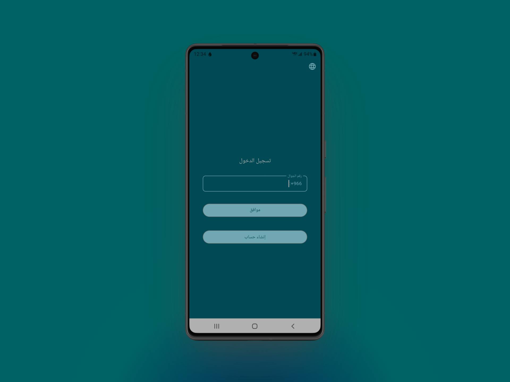
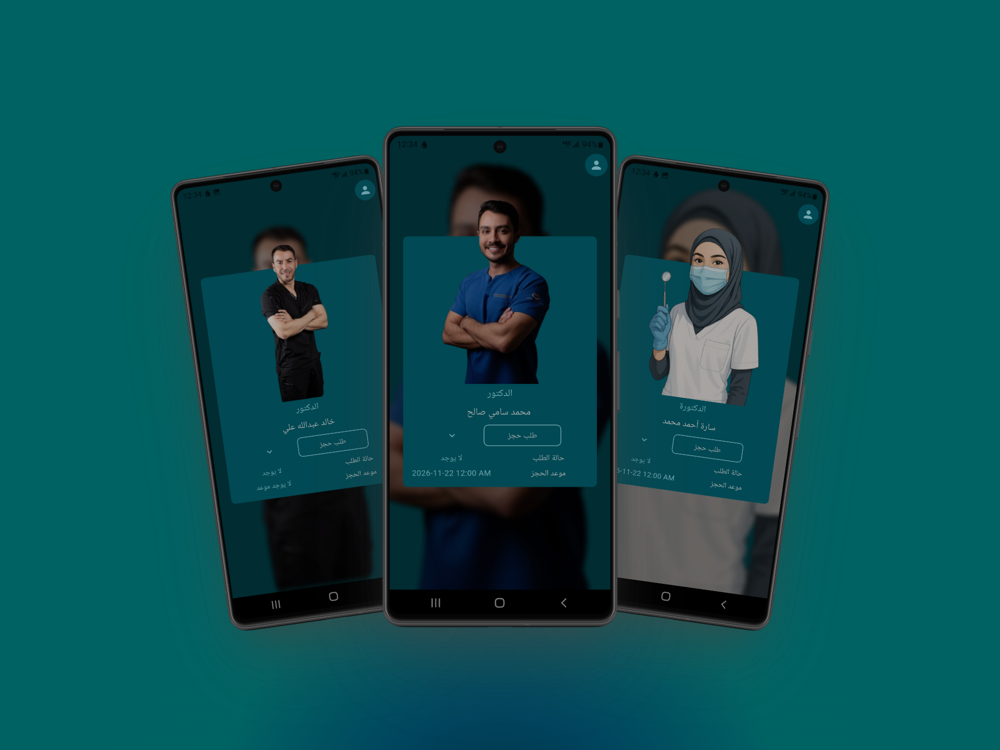
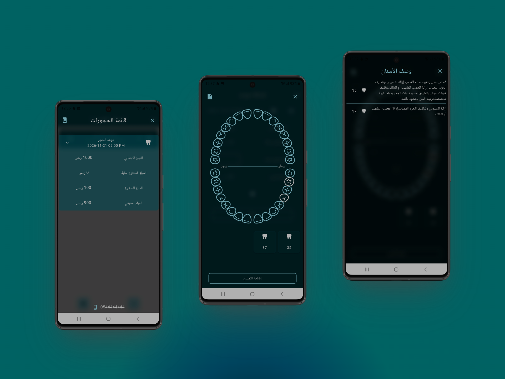
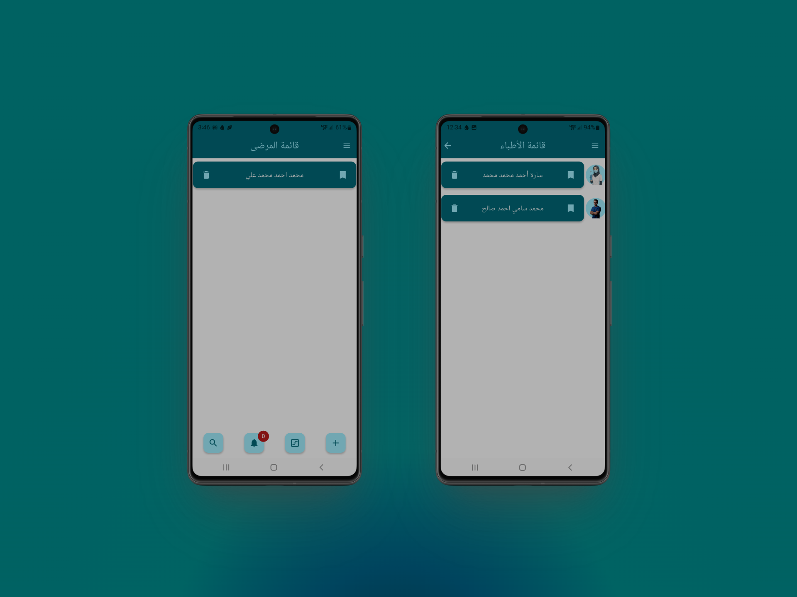
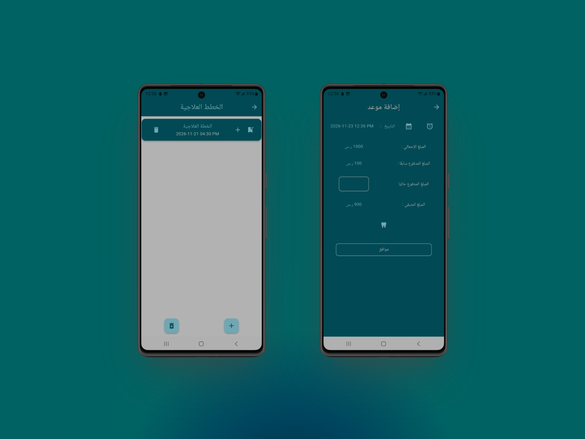
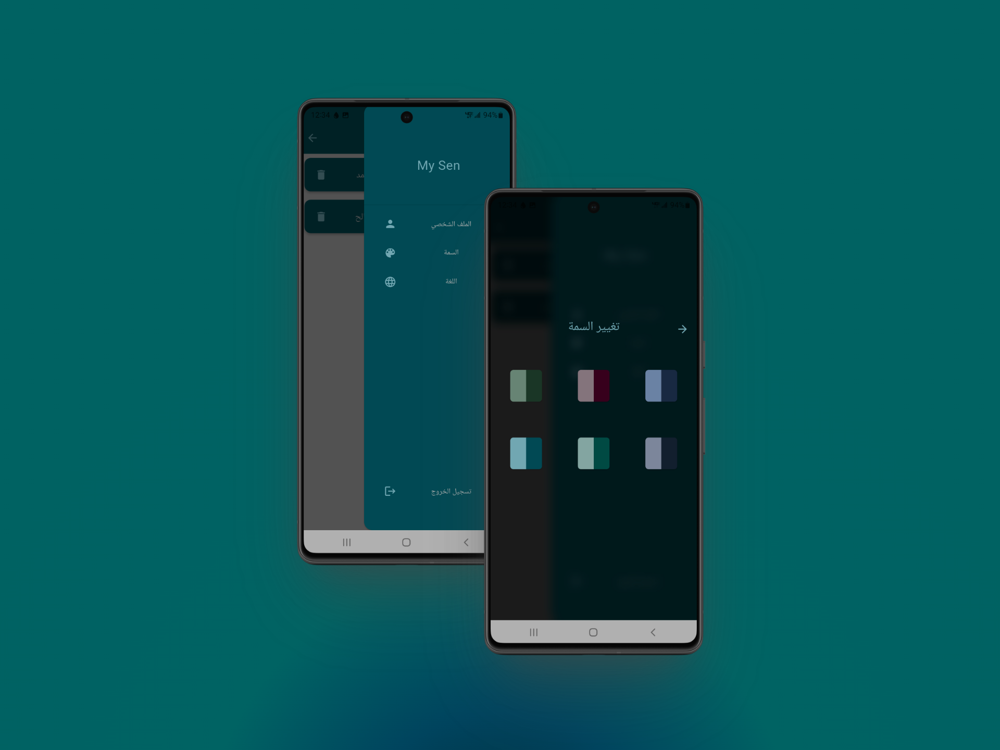
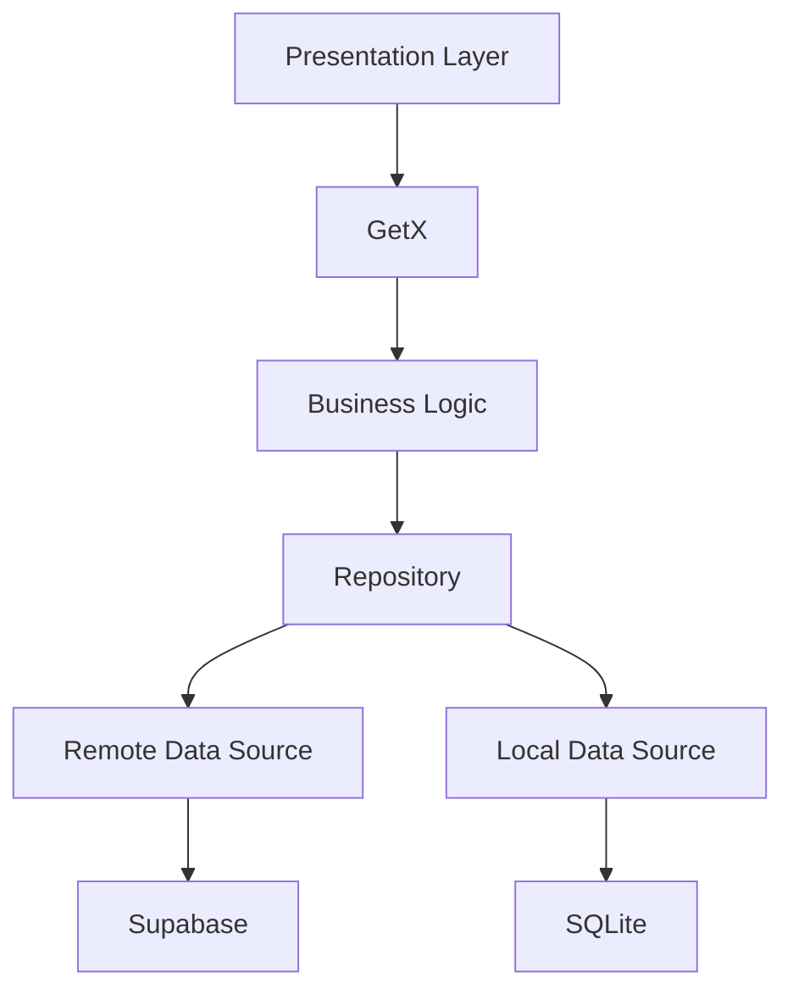

# 🦷 MySen - Dental Clinic Management System

A cross-platform dental clinic management and appointment booking application built with **Flutter and Dart**.

MySen connects dentists and patients through dedicated workflows for patient management, appointment scheduling, dental treatment records, and payment tracking.

The application focuses on maintainable code structure, efficient state management, and local data persistence.

---

## 📱 Screenshots

### 🔐 Authentication

Provides sign-in and sign-up interfaces for both doctors and patients.

<p align="center">
  
</p>

### 👨‍⚕️ Doctors

Displays a list of available doctors, allowing patients to browse and explore their profiles.

<p align="center">
  
</p>

### 🦷 Dental Chart

Displays appointment details and an interactive dental chart that allows doctors to select treated teeth and add descriptions for each tooth.

<p align="center">
  
</p>


### 👥 Doctor-Patient Management

Displays patient records accessible to the doctor, along with the doctors associated with each patient.

<p align="center">
  
</p>


Displays treatment records and provides an interface for scheduling new appointments.

<p align="center">
  
</p>

### 🎨 Application Themes

Allows users to customize the application's appearance through six different themes.

<p align="center">
  
</p>

---

## ✨ Features

### 👨‍⚕️ Doctor Features

- Manage personal patient records.
- Add patients using their phone numbers.
- Search and filter patients.
- Manage doctor-patient relationships.
- Receive, accept, and reject appointment requests.
- Schedule and manage patient appointments.
- View appointments by date.
- Create and manage treatment records.
- Use an interactive dental chart to select treated teeth.
- Add treatment descriptions for individual teeth.
- Track treatment costs, payments, and remaining balances.
- Receive appointment notifications.
- Manage profile information and qualifications.
- Enable or disable booking availability.
- Customize the application with six themes and multilingual support.

### 🧑‍💻 Patient Features

- Browse available doctors.
- View doctor profiles and information.
- Send appointment booking requests.
- Cancel pending booking requests.
- View appointments and treatment history.
- View treated teeth and their treatment descriptions.
- Track treatment information associated with each doctor.

---

## 🔐 Data Privacy & Access Control

- Role-based access for doctors and patients.
- Doctors can access only their own patients' records.
- Patients can access their own information and records associated with their doctors.
- Patient records can be linked to multiple doctors while keeping each doctor's data separate.
- Existing patient records can be linked to a newly registered patient account using the same phone number.

---

## 🏗️ Architecture

The application follows a **Clean Architecture-based approach**, inspired by Clean Architecture principles, to organize code responsibilities and improve maintainability, reusability, and scalability.

The project uses a layered structure to separate presentation, business logic, and data management responsibilities.

### Architecture Layers

| Layer | Responsibility |
|---|---|
| Presentation | UI, state management, and user interactions using GetX |
| Domain | Business logic, entities, repository contracts, and use cases |
| Data | Repository implementations, models, and data sources |
| Remote Data Source | Supabase integration |
| Local Data Source | SQLite local database |

### State Management

The application uses **GetX** for:

- State management.
- Dependency injection.
- Navigation.
- Reactive UI updates.

### Data Flow



The repository layer coordinates data access between remote and local data sources, helping manage online and offline operations.

---

## 🛠️ Tech Stack

| Technology | Purpose |
|---|---|
| Flutter | Cross-platform mobile development |
| Dart | Programming language |
| GetX | State management, dependency injection, and navigation |
| Supabase | Backend services |
| PostgreSQL | Relational database |
| SQLite (sqflite) | Local data persistence |
| SharedPreferences | Local storage for theme and language preferences |
| REST APIs | API communication |
| Git & GitHub | Version control |

---

## 💾 Data Management

The application uses **Supabase** and **SQLite** to manage remote and local data.

### 👨‍⚕️ Doctor Side

- Reads application data from SQLite.
- On the first launch, if the local database is empty, data is fetched from Supabase and stored locally.
- When online, create, update, and delete operations are performed on Supabase first.
- Local SQLite data is updated after the remote operation succeeds.
- Existing local data is used when the application is reopened.

### 🧑‍💻 Patient Side

- Fetches data from Supabase when an internet connection is available.
- Uses SQLite to access locally stored data when offline.

---

## 🦷 Treatment Management

The treatment management system supports multiple appointments within a treatment case.

Each treatment can include:

- Multiple appointments.
- One or more treated teeth.
- Individual descriptions for each treated tooth.
- Total treatment cost.
- Payments recorded across appointments.
- Automatically calculated remaining balance.

### Remaining Balance Calculation

```text
Remaining Balance = Total Treatment Cost - Total Payments
```

---

## 🔔 Notifications

The application includes appointment reminder notifications to help patients remember their scheduled visits.

---

## 🚀 Getting Started

### Prerequisites

Make sure you have the following installed:

- Flutter SDK
- Dart SDK
- Android Studio or VS Code
- Supabase account

### Installation

**1. Clone the repository**

```bash
git clone YOUR_REPOSITORY_URL
```

**2. Navigate to the project directory**

```bash
cd YOUR_PROJECT_DIRECTORY
```

**3. Install dependencies**

```bash
flutter pub get
```

**4. Configure Supabase**

Configure your Supabase credentials according to the project's configuration.

**5. Run the application**

```bash
flutter run
```

---

## 🔒 Authentication Note

The current phone verification flow is simulated inside the application.

It does not currently send real SMS OTP messages.

---

## 📌 Project Goals

This project was developed to demonstrate practical experience in:

- Building real-world Flutter applications.
- Applying Clean Architecture-based principles.
- Managing application state using GetX.
- Implementing dependency injection.
- Integrating Supabase and PostgreSQL.
- Implementing local data persistence with SQLite.
- Designing online/offline data management.
- Building complex business workflows.
- Managing relational data and user permissions.
- Developing reusable and maintainable application components.

---

## 👨‍💻 Developer

**YOUR NAME**

Flutter Developer

- LinkedIn: www.linkedin.com/in/esmail-alfahad